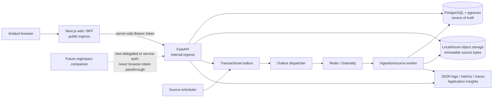

# Companion Phase 0 architecture and integration audit

Date: 2026-11-14

Scope: read-only inspection of the `regimpact-ai` repository at the working-tree revision used for this audit. No companion repository was created and no application, migration, infrastructure, API, or test code was changed.

## Reading this audit

- **Verified** means the statement is directly supported by implementation, migration, test, or deployment configuration in this repository.
- **Inference** means it follows from verified implementation but is not itself an implemented contract.
- **Recommendation** means a proposed integration or governance decision; it is not presented as current behavior.

The current code is the authority where documentation and implementation differ. In particular, Azure Blob storage is implemented even though `docs/ingestion-security.md` still lists an Azure Blob adapter as pending (`apps/api/src/regimpact/storage.py::AzureBlobObjectStorage`; `infra/main.bicep::commonEnv`; `docs/ingestion-security.md::Deliberately pending`).

## 1. Current boundaries and component map

**Verified.** RegImpact AI is a modular monolith with separately executed Next.js web, FastAPI API, Dramatiq worker, outbox dispatcher, source scheduler, and Alembic migration workloads. PostgreSQL is the authoritative store for tenants, identities, regulatory/version lineage, derived workflow state, and audit rows; object storage owns source bytes; Redis is queue transport; the search table is a rebuildable projection (`README.md::Repository layout`; `apps/api/src/regimpact/db_models.py`; `apps/api/src/regimpact/broker.py`; `apps/api/src/regimpact/storage.py`; `apps/api/src/regimpact/retrieval.py`; `apps/api/migrations/versions/20260901_0006_hybrid_search.py`).

### Boundary inventory

| Boundary | Verified responsibility | Evidence |
| --- | --- | --- |
| Next.js web/BFF | Stores the access token in an HTTP-only, SameSite=Lax cookie; forwards it from server routes; redirects unauthenticated page requests. It is not a general integration API. | `apps/web/app/api/auth/login/route.ts::POST`; `apps/web/lib/api.ts::apiGet`; `apps/web/proxy.ts::proxy` |
| FastAPI | Authentication/RBAC, tenant-scoped API reads and writes, validation, retrieval, analyst workflow, request correlation, and operational endpoints. | `apps/api/src/regimpact/main.py::create_app`; routers in `api.py`, `controls_api.py`, `review_api.py`, `agent_api.py`, `auth_api.py`, `operations_api.py` |
| PostgreSQL | Canonical organizations, users, immutable regulation/control versions, sections, changes, obligations, mappings, decisions, workflow proposals, job state, search projection, and audit events. | `apps/api/src/regimpact/db_models.py`; migrations `20260825_0001` through `20260903_0012` |
| Object storage | Content-addressed, tenant-prefixed source bytes through local filesystem or Azure Blob managed identity. | `apps/api/src/regimpact/storage.py::LocalObjectStorage`; `AzureBlobObjectStorage`; `infra/main.bicep::blobRole` |
| Background plane | Transactional outbox, scheduled source claims, Redis/Dramatiq dispatch, worker leases, bounded retries, and dead letters. | `apps/api/src/regimpact/outbox.py::publish_pending`; `scheduler.py`; `dispatcher.py`; `tasks.py`; `ingestion_service.py` |
| Deployment | Public web, internal API, worker, scheduled dispatcher/scheduler jobs, migration job, PostgreSQL, Redis, Blob, Key Vault, ACR, and Application Insights. | `infra/main.bicep`; `.github/workflows/deploy-azure.yml`; `docs/azure-deployment.md::Deployed topology` |

**Verified limitation.** Azure production is not approved. The repository explicitly leaves private networking, workforce identity, enterprise malware scanning, restore drills, and retention policy outside the verified release (`docs/azure-deployment.md::Known production boundary`; `docs/release-audit-v0.5.md::Production deployment is not approved`; `infra/main.bicep::postgresFirewall`, `redis`).

## 2. Reusable API capability inventory

### Authorization notation

- **Public**: no application authentication dependency.
- **Authenticated**: active database user in any of `admin`, `analyst`, or `viewer`.
- **Reviewer**: `admin` or `analyst`.
- **Admin**: `admin` only.
- Every authenticated identity is resolved to a database user and organization; the API does not accept a caller-selected tenant in JWT mode (`apps/api/src/regimpact/auth.py::get_current_user`, `require_roles`).

Unless a row says otherwise, request and response models are defined in `apps/api/src/regimpact/schemas.py`; stable error envelopes are defined in `apps/api/src/regimpact/main.py::create_app`.

### Identity and operations

| Method and route | Purpose | Authentication / authorization | Request -> response | Tenant boundary | Implementation and tests |
| --- | --- | --- | --- | --- | --- |
| `POST /api/v1/auth/login` | Credential login and token issue | Public | `LoginRequest` -> `TokenResponse` | Email lookup is global; returned identity supplies tenant. Successful login is audited. | `auth_api.py::login`, `_login`; `tests/test_auth.py::test_login_returns_short_lived_token_and_audits_success` |
| `POST /api/v1/auth/demo-login` | Local demo role selector | Public, but hidden unless non-production demo mode is enabled | `DemoLoginRequest` -> `TokenResponse` | Selected configured demo user supplies tenant. | `auth_api.py::demo_login`; `config.py::validate_security_settings`; `tests/test_auth.py::test_demo_login_is_hidden_by_default` |
| `GET /api/v1/auth/me` | Current identity | Authenticated | none -> `AuthenticatedUserResponse` | Token and active DB user bind organization. | `auth_api.py::me`; `auth.py::get_current_user` |
| `GET /api/v1/auth/users` | List tenant users | Admin | none -> `list[UserResponse]` | `UserRecord.organization_id == admin.organization_id`. | `auth_api.py::list_users`; `tests/test_auth.py` |
| `POST /api/v1/auth/users` | Create tenant user | Admin | `UserCreate` -> `UserResponse` | New user is forced into admin's organization; creation is audited. | `auth_api.py::create_user`; `db_models.py::UserRecord` |
| `POST /api/v1/organizations` | Placeholder organization provisioning | Admin, then always `403` | `OrganizationCreate` -> declared `OrganizationResponse`, never returned | No provisioning occurs. | `api.py::add_organization`; `tests/test_api_contract.py::test_validation_error_uses_stable_envelope_and_generated_request_id` |
| `GET /health` | Process liveness/version | Public | none -> object | No tenant data. | `main.py::health`; `tests/test_api_contract.py`; `tests/test_observability.py` |
| `GET /startup` | Process startup probe | Public | none -> object | No tenant data. | `main.py::startup`; `infra/main.bicep::api probes` |
| `GET /ready` | PostgreSQL/Redis readiness | Public, but Azure API ingress is internal | none -> object, `200` or `503` | Global dependency status only. | `main.py::ready`; `operations_api.py::dependency_checks`; `apps/web/app/api/platform/readiness/route.ts::GET` |
| `GET /metrics` | Prometheus request/reliability metrics | Public and omitted from OpenAPI; Azure API ingress is internal | none -> Prometheus text or `404` when disabled | Reliability counts are global, not tenant-scoped. | `main.py::prometheus_metrics`; `observability.py::Metrics.render`; `operations_api.py::reliability_metrics`; `tests/test_observability.py::test_metrics_are_prometheus_formatted` |
| `GET /api/v1/operations/snapshot` | Tenant operational summary | Admin | none -> untyped object | Ingestion/outbox queries filter admin organization; in-process request counts are global. | `operations_api.py::operational_snapshot`; `tests/test_auth.py::test_operational_snapshot_is_admin_only` |

### Regulatory source, version, change, and ingestion APIs

| Method and route | Purpose | Authentication / authorization | Request -> response | Tenant boundary | Implementation and tests |
| --- | --- | --- | --- | --- | --- |
| `POST /api/v1/regulations` | Create regulation metadata | Admin | `RegulationCreate` -> `RegulationResponse` | Organization comes from authenticated admin. | `api.py::add_regulation`; `repository.py::create_regulation`; `tests/test_persistence.py` |
| `GET /api/v1/regulations` | List regulations with rollups | Authenticated | query none -> `list[RegulationListItem]` | Base query filters organization; rollup subqueries are joined through owned regulations. | `api.py::list_regulations`; `tests/test_read_api.py::test_read_endpoints_enforce_organization_boundary` |
| `POST /api/v1/regulations/{regulation_id}/versions` | Directly create an immutable version and changes | Admin | `VersionCreate` -> `VersionResponse` | Repository verifies regulation ownership. | `api.py::ingest_version`; `versioning.py::VersioningService.ingest`; `repository.py::SqlAlchemyVersionRepository`; `tests/test_persistence.py` |
| `GET /api/v1/regulations/{regulation_id}/versions` | List version lineage | Authenticated | path/query -> `list[VersionSummary]` | `owned_regulation` is checked before version query. | `api.py::list_versions`; `repository.py::owned_regulation`; `tests/test_read_api.py` |
| `GET /api/v1/changes` | Paginated change register | Authenticated | `regulation_id?`, `latest_only`, `limit`, `offset` -> `list[ChangeRegisterItem]` | Query joins owned `RegulationRecord`. | `api.py::list_changes`; `tests/test_read_api.py` |
| `GET /api/v1/changes/{change_id}` | Old/new text and citations | Authenticated | path -> `ChangeDetail` | Change lookup requires owned regulation; foreign item becomes `404`. | `api.py::get_change`; `tests/test_read_api.py::test_register_returns_latest_version_changes_and_citations` |
| `POST /api/v1/regulations/{regulation_id}/ingestions` | Validate/store PDF or HTML and enqueue ingestion | Admin | multipart `upload` -> `IngestionJobResponse` (`202`) | Ownership is checked; object path and job are organization-prefixed. | `api.py::upload_regulation_document`; `ingestion.py::validate_upload`; `ingestion_service.py::queue_ingestion`; `tests/test_ingestion.py`, `tests/test_persistence.py` |
| `GET /api/v1/ingestions/{job_id}` | Job state | Authenticated | path -> `IngestionJobResponse` | Job ID plus organization filter. | `api.py::get_ingestion_job`; `tests/test_ingestion_reliability.py` |
| `GET /api/v1/ingestions` | Recent job states | Authenticated | `limit` -> `list[IngestionJobState]` | Organization filter. | `api.py::list_ingestions`; `tests/test_ingestion_reliability.py` |
| `POST /api/v1/ingestions/{job_id}/replay` | Replay failed/dead-letter job | Admin | path -> `IngestionJobState` | Locked job lookup filters organization; replay is audited. | `api.py::replay_ingestion`; `ingestion_service.py::replay_dead_letter`; `tests/test_ingestion_reliability.py::test_admin_replay_resets_failure_and_writes_outbox` |
| `POST /api/v1/sources` | Register monitored HTTPS source | Admin | `RegulatorySourceCreate` -> `RegulatorySourceResponse` | Regulation ownership is checked; row stores organization. | `api.py::add_regulatory_source`; `source_client.py::validate_source_url`; `tests/test_source_monitoring.py` |
| `GET /api/v1/sources` | List monitored sources | Authenticated | none -> `list[RegulatorySourceResponse]` | Organization filter. | `api.py::list_regulatory_sources`; `tests/test_read_api.py` |
| `GET /api/v1/system/queue-health` | Tenant queue/dead-letter counts | Authenticated | none -> `{pending_outbox, exhausted_outbox, dead_letter_ingestions}` | Every count filters organization. | `api.py::queue_health`; `tests/test_ingestion_reliability.py` |

### Extraction, retrieval, and control APIs

| Method and route | Purpose | Authentication / authorization | Request -> response | Tenant boundary | Implementation and tests |
| --- | --- | --- | --- | --- | --- |
| `POST /api/v1/versions/{version_id}/obligations/extract` | Run deterministic extraction | Admin | path -> `ObligationExtractionResponse` | Version query joins owned regulation; results store organization. | `api.py::extract_version_obligations`; `obligation_service.py::extract_and_store_obligations`; `tests/test_obligation_extraction.py` |
| `GET /api/v1/obligations` | List evidence-linked candidates | Authenticated | filters + pagination -> `list[ObligationResponse]` | Query joins owned regulation. | `api.py::list_obligations`; `tests/test_obligation_extraction.py::test_api_extracts_and_returns_version_page_lineage` |
| `POST /api/v1/versions/{version_id}/clauses/classify` | Run promoted transformer classifier | Admin | path -> `ClauseClassificationRunResponse` | Service verifies owned version; disabled/unpromoted model fails closed. | `api.py::classify_version_clauses`, `clause_classifier`; `clause_classification_service.py`; `tests/test_clause_classification_service.py` |
| `GET /api/v1/clause-classifications` | List model-labelled clauses | Authenticated | filters + pagination -> `list[ClauseClassificationResponse]` | Query joins owned regulation. | `api.py::list_clause_classifications`; `tests/test_clause_classification_service.py` |
| `GET /api/v1/system/calibration-policy` | Static extraction calibration metadata | **Public** | none -> `CalibrationPolicyResponse` | No tenant data. | `api.py::calibration_policy`; `calibration.py::CURRENT_POLICY`; `tests/test_calibration.py` |
| `POST /api/v1/versions/{version_id}/search-index` | Index tenant version with configured embedding model | Admin | path -> `SearchIndexResponse` | Index query requires version through owned regulation; index rows include organization. | `api.py::create_search_index`; `retrieval.py::index_version`; `tests/test_retrieval.py::test_api_contract_indexes_and_searches` |
| `GET /api/v1/search` | Hybrid section retrieval | Authenticated | `q`, `limit` -> `HybridSearchResponse` | Lexical/vector candidate queries and joined read filter organization and model. | `api.py::search_regulatory_evidence`; `retrieval.py::hybrid_search`; `tests/test_retrieval.py::test_tenant_isolation_applies_to_index_and_search` |
| `POST /api/v1/controls` | Create/version control | Admin | `ControlCreate` -> `ControlResponse` | Lookup/create uses authenticated organization. | `controls_api.py::create_control`; `control_mapping.py::add_control`; `tests/test_controls_api.py`; `tests/test_auth.py::test_viewer_cannot_create_controls` |
| `GET /api/v1/controls` | List latest active controls | Authenticated | none -> `list[ControlResponse]` | Control query filters organization. | `controls_api.py::list_controls`; `tests/test_controls_api.py` |
| `GET /api/v1/control-mappings` | List mapping candidates | Authenticated | `limit` -> `list[ControlMappingListItem]` | Mapping query filters organization. | `controls_api.py::list_control_mappings`; `tests/test_controls_api.py` |
| `POST /api/v1/obligations/{obligation_id}/control-mappings/suggest` | Deterministic token-overlap control candidates | Reviewer | path -> `MappingSuggestionResponse` | Obligation, controls, and saved mappings filter organization; operation is audited. | `controls_api.py::suggest_control_mappings`; `control_mapping.py::suggest_mappings`; `tests/test_control_mapping.py` |

### Analyst review and controlled workflow APIs

| Method and route | Purpose | Authentication / authorization | Request -> response | Tenant boundary | Implementation and tests |
| --- | --- | --- | --- | --- | --- |
| `GET /api/v1/review-queue` | Filter/sort/paginate obligation review items | Authenticated | state/regulation/section/control/query/confidence/sort/pagination -> `ReviewQueueResponse` | Obligations, mappings, and decisions filter organization. | `review_api.py::review_queue`, `_review_items`; `tests/test_review_workflow.py::test_queue_exposes_evidence_candidate_and_pagination` |
| `GET /api/v1/review-queue/{obligation_id}` | Review detail | Authenticated | path -> `ReviewQueueItem` | Selects from tenant-built queue; foreign item is `404`. | `review_api.py::review_detail`; `tests/test_review_workflow.py::test_tenant_cannot_read_or_decide_another_tenants_work` |
| `POST /api/v1/obligations/{obligation_id}/mapping-decisions` | Append analyst decision with rationale | Reviewer | `mapping_id?` + `MappingDecisionCreate` -> `MappingDecisionResponse` (`201`) | Obligation and mapping must belong to organization; idempotency key is organization-scoped. | `review_api.py::create_decision`; `review_workflow.py::decide_mapping`; `tests/test_review_workflow.py::test_decision_is_idempotent_audited_and_stale_safe` |
| `POST /api/v1/agent-workflows` | Create bounded, evidence-grounded proposal | Reviewer | `AgentWorkflowCreate` -> `AgentWorkflowResponse` (`201`) | Obligation/mappings filter organization; run stores organization and creator. | `agent_api.py::start_workflow`; `agent_workflow.py::create_workflow`; `tests/test_agent_workflow.py::test_proposal_is_grounded_gated_and_idempotent` |
| `GET /api/v1/agent-workflows` | List workflow runs | Authenticated | `limit` -> `list[AgentWorkflowResponse]` | Organization filter. | `agent_api.py::list_workflows`; `tests/test_agent_workflow.py` |
| `GET /api/v1/agent-workflows/{run_id}` | Workflow detail/latest decision | Authenticated | path -> `AgentWorkflowResponse` | ID plus organization filter. | `agent_api.py::get_workflow`; `agent_workflow.py::latest_decision_revision` |
| `POST /api/v1/agent-workflows/{run_id}/decisions` | Append approval/rejection/change request | Admin | `AgentWorkflowDecisionCreate` -> `AgentWorkflowDecisionResponse` | Run and idempotency key are organization-scoped; high-risk creator cannot approve own run. | `agent_api.py::record_workflow_decision`; `agent_workflow.py::decide_workflow`; `tests/test_agent_workflow.py::test_high_risk_requires_different_approver_and_is_audited` |

**Inference.** The read APIs are reusable building blocks for a companion, but the entire current `/api/v1` surface is not a companion contract. It combines public probes, browser identity, administrative ingestion/model controls, analyst decisions, and operational endpoints without OAuth-style scopes or a service-principal type.

**Verified tenant-enforcement boundary.** Tenant isolation is implemented in application queries and service lookups; the migrations do not enable PostgreSQL row-level security, and most foreign keys do not use composite organization keys (`db_models.py`; migrations `20260825_0001` through `20260903_0012`). This makes the HTTP/service layer—not direct database access—the mandatory tenant security boundary.

## 3. Retrieval and citation contracts

### Verified retrieval contract

- Version sections are indexed by `(section_id, embedding_model_id)` with organization, regulation, version, content hash, searchable text, 384-dimensional embedding, and index timestamp (`db_models.py::SectionSearchRecord`; migration `20260901_0006_hybrid_search.py::upgrade`).
- PostgreSQL search applies organization and embedding-model filters inside both lexical and vector candidate queries, then reciprocal-rank fusion; SQLite has a deterministic test adapter (`retrieval.py::hybrid_search`; `tests/test_retrieval.py`).
- API results include the exact stored section body plus `section_id`, `regulation_id`, `version_id`, `section_key`, heading, page, source URI, version ordinal, fused/lexical/vector scores, and embedding model (`schemas.py::RetrievalHitResponse`; `api.py::search_regulatory_evidence`).
- Indexing is application-idempotent for an already indexed section/model and tenant isolation is tested (`retrieval.py::index_version`; `tests/test_retrieval.py::test_index_is_idempotent_and_search_returns_citation_lineage`).
- Search covers only explicitly indexed versions. No ingestion hook automatically creates the search index (`ingestion_service.py::process_ingestion_job`; `api.py::create_search_index`).

### Citation validity is not claim support

**Verified — citation validity/lineage.** A retrieval result is citation-addressable because it is produced from a tenant-filtered join of the index, section, and version and returns stable row identifiers and source coordinates. Change detail returns old/new version ordinal, page, and URI alongside old/new text (`retrieval.py::hybrid_search`; `api.py::get_change`; `schemas.py::CitationResponse`, `ChangeDetail`). Obligation responses return an evidence quote plus section/version/page/URI lineage (`api.py::_obligation_response`; `obligation_service.py::extract_and_store_obligations`). Agent workflow evidence adds the regulation-version content hash (`agent_workflow.py::create_workflow`).

**Verified limitations to citation validity.** `RetrievalHitResponse` does not return the search row's `content_hash` or the regulation version's `content_hash`; `CitationResponse` contains only version ID/ordinal, page, and URI; pages are nullable; and there is no public evidence-dereference or citation-validation endpoint (`schemas.py::CitationResponse`, `RetrievalHitResponse`; `db_models.py::SectionSearchRecord`). For uploaded documents, the created version's `source_uri` is the internal storage URI, not necessarily the original regulator URL (`ingestion_service.py::process_ingestion_job`).

**Verified — no runtime claim-support guarantee.** Retrieval score is lexical/vector relevance, not entailment. The agent's runtime `citation_complete` gate checks only that an evidence quote and source URI are non-empty. It does not verify that the quote supports the proposal or that individual generated claims map to evidence (`retrieval.py::hybrid_search`; `agent_workflow.py::create_workflow`, `policy_results`). `agent_evaluation.py::evaluate` can score a caller-supplied `proposal_supported` label in an offline evaluation row, but no runtime service computes that label. Control mapping is token overlap and is a candidate-ranking signal, not proof that a control satisfies an obligation (`control_mapping.py::suggest_mappings`; `mapping_evaluation.py::evaluate`).

**Recommendation.** The companion should represent each answer claim separately with one or more immutable evidence references and a support state such as `supported`, `partially_supported`, `contradicted`, or `insufficient_evidence`. Citation validity should be checked independently from support. RegImpact should return or resolve `organization-bound section_id + version_id + version_content_hash + exact quote/body hash + page + source URI`; the companion should own claim decomposition/support evaluation and abstain when support is insufficient. A valid citation must never be displayed as proof of support by itself.

## 4. Authentication, audiences, and service identity

### Current verified behavior

- Access tokens are custom HS256 JWTs issued by RegImpact. Claims are `sub`, `org`, `role`, `iat`, `exp`, `iss="regimpact-api"`, and `aud="regimpact-web"`; default lifetime is 30 minutes (`auth.py::issue_access_token`; `config.py::access_token_minutes`).
- Validation accepts only the exact HS256 header, the fixed issuer/audience, a non-expired token, and a matching active `(user_id, organization_id)` database record whose current role equals the token role (`auth.py::_decode_access_token`, `get_current_user`; `tests/test_auth.py::test_signed_token_resolves_database_identity_and_rejects_tampering`).
- Credential login looks up a lower-cased email without an organization discriminator, while the database uniqueness constraint is only `(organization_id, email)`. Two tenants may therefore hold the same email and make `_login(...).one_or_none()` ambiguous; the existing tests cover one tenant, not this case (`auth_api.py::_login`; `db_models.py::UserRecord`; migration `20260901_0009_auth_rbac.py`; `tests/test_auth.py`).
- The browser token is held in an HTTP-only, SameSite=Lax cookie and forwarded server-side by Next.js (`apps/web/app/api/auth/login/route.ts::POST`; `apps/web/lib/api.ts::apiGet`). There are no refresh tokens, MFA, external OIDC, centralized revocation, or rate limiting (`docs/authentication-and-rbac.md::Known limits`).
- `legacy_headers` supplies an admin test identity and is rejected in production (`auth.py::get_current_user`; `config.py::validate_security_settings`).
- Background worker/scheduler/dispatcher calls do not authenticate to HTTP. They receive explicit organization IDs in database/outbox payloads and use shared database/queue credentials; Azure workloads also share one user-assigned managed identity (`tasks.py`; `outbox.py`; `infra/main.bicep::identity`, `commonEnv`).

### Companion consequence

**Blocking finding.** A companion is not the `regimpact-web` audience. Current tokens have no scopes, authorized-party/client identifier, machine-principal type, or companion audience, and all API authorization assumes a database `UserRecord`. Reusing or forwarding a browser/BFF token into a separate companion would violate the audience boundary and would couple the companion to a bearer token it should not possess (`auth.py::issue_access_token`, `_decode_access_token`, `get_current_user`).

**Recommendation — delegated user calls.** Use a real identity provider and a server-side token exchange/delegation flow. The companion authenticates the user in its own front channel, exchanges that independently validated identity for a short-lived token whose audience is the RegImpact API, and receives only tenant-bound scopes needed for the call. The API must validate issuer, API audience, expiry, authorized client, subject, tenant membership, and scopes. No user/browser token passthrough should be used.

**Recommendation — non-user work.** Companion background evaluation, prefetch, or indexing work requires a narrowly scoped service credential (prefer workload identity/client credentials with asymmetric signing), a machine principal, explicit tenant grants, and read-only scopes by default. Service credentials must not impersonate `admin` and must not be able to approve workflows or mapping decisions.

**Recommendation — separate cases.** Token exchange is required where a human's identity and authority must be preserved (review reads, drafting, or explicitly delegated mutations). A service credential is required only for autonomous background work with no human authority. Approval and review decisions should continue to require a human subject and separation-of-duties rules.

## 5. Audit, lineage, idempotency, rate limits, retries, errors, and observability

### Audit and lineage

**Verified.** `AuditEventRecord` records organization, actor, event/entity identity, JSON detail, and timestamp. Application services append events for successful login/user creation; regulation-version creation; ingestion queue/completion/failure/retry/dead-letter/replay; obligation extraction; clause classification; mapping suggestion; mapping decision/supersession; and workflow creation/decision (`db_models.py::AuditEventRecord`; all `AuditEventRecord(` call sites in `auth_api.py`, `repository.py`, `ingestion_service.py`, `tasks.py`, `obligation_service.py`, `clause_classification_service.py`, `control_mapping.py`, `review_workflow.py`, `agent_workflow.py`).

**Verified limitations.** Append-only behavior is an application convention, not a database immutability policy. There is no audit read/export API, no database trigger or write-once storage, and audit details do not uniformly persist request ID, trace ID, idempotency key, input/output hashes, or originating client. Regulation creation, source creation, control creation/versioning, indexing, reads, and login failures do not create audit events (`db_models.py::AuditEventRecord`; `repository.py::create_regulation`; `api.py::add_regulatory_source`, `create_search_index`; `control_mapping.py::add_control`; `auth_api.py::_login`).

**Recommendation.** Before cross-repository writes, define one cross-system operation ID propagated as `X-Request-ID`/trace context and persisted in the authoritative audit row along with client ID, delegated subject/service principal, scope, tenant, idempotency key, input hash, result identity, and policy decision. Provide a tenant-authorized audit export/read API or event feed; do not give the companion direct database access.

### Idempotency and concurrency

| Contract | Verified behavior | Caveat / evidence |
| --- | --- | --- |
| Ingestion | Unique `(organization_id, regulation_id, content_hash)`; duplicate enqueue returns existing job and `created=false`. | `db_models.py::IngestionJobRecord`; `ingestion_service.py::queue_ingestion` |
| Versioning | Same-as-latest raw content returns existing version; DB also makes `(regulation_id, content_hash)` unique. | `versioning.py::VersioningService.ingest`; `db_models.py::RegulationVersionRecord` |
| Extraction/classification/index | Unique run keys for version+method/model and section+embedding model; services return existing counts/results. | `ObligationExtractionRunRecord`, `ClauseClassificationRunRecord`, `SectionSearchRecord`; respective services and tests |
| Mapping decisions | Organization-scoped idempotency key, target-reuse check, row lock/revision check, append-only supersession. | `review_workflow.py::decide_mapping`; `tests/test_review_workflow.py::test_decision_is_idempotent_audited_and_stale_safe` |
| Agent decisions | Organization-scoped key, run-reuse check, row lock/revision check. | `agent_workflow.py::decide_workflow`; `db_models.py::AgentWorkflowDecisionRecord` |
| Agent workflow creation | Organization-scoped key returns an existing run. | **Caveat:** it does not reject reuse for a different obligation or goal; it simply returns the earlier run (`agent_workflow.py::create_workflow`). |
| Controls and mapping suggestions | Controls look up content hash in application code; suggestions reuse existing method results. | **Caveat:** control content hash is not a DB unique constraint, and a zero-result suggestion has no run marker (`control_mapping.py::add_control`, `suggest_mappings`; `db_models.py::ControlVersionRecord`). |

**Recommendation.** Companion mutations must supply strong, opaque idempotency keys and a canonical request hash. RegImpact should reject a reused key whose request hash/target differs, including workflow creation, and enforce uniqueness in the database where concurrency matters.

### Rate limits and retries

**Verified.** There is no HTTP rate-limit middleware, per-user/client quota, `429` contract, or `Retry-After` behavior in the API or web BFF (`main.py::create_app`; `docs/authentication-and-rbac.md::Known limits`).

**Verified.** Background reliability is materially stronger: ingestion uses database leases, heartbeat/expiry fields, bounded exponential backoff with jitter, configurable attempts, transient/permanent classification, and dead-letter state; outbox publication uses `FOR UPDATE SKIP LOCKED`, exponential retry up to 10 attempts, and dead-lettering; the scheduler and cloud dispatcher use bounded one-shot execution (`ingestion_service.py::claim_ingestion_job`, `retry_delay_seconds`; `tasks.py::process_ingestion`; `outbox.py::publish_pending`; `dispatcher.py::drain_pending`; `tests/test_ingestion_reliability.py`; `tests/test_background_entrypoints.py`). Source checks use conditional HTTP, disallow redirects, and back off source polling after failure (`source_client.py::SafeSourceClient.fetch`; `source_monitor.py::run_source_check`).

**Recommendation.** Add client/tenant/route quotas before companion exposure, with tighter limits on login, retrieval, workflow creation, and other computational or consequential routes. Publish retryability, maximum attempts, backoff, `Retry-After`, and idempotency rules. The companion should retry only transport failures, `429`, and documented transient `5xx`, never validation/authorization errors, and only when the operation is idempotent.

### Errors

**Verified.** FastAPI defines request-correlated JSON envelopes for `ValueError`/validation (`422`), `HTTPException`, not found (`404`), uniqueness conflicts (`409`), stale review (`409`), and malware-scanner outage (`503`) (`main.py::create_app`; `tests/test_api_contract.py`). Responses include `X-Request-ID`, `X-Trace-ID`, `traceparent`, and timing headers (`main.py::request_context`).

**Verified limitations.** Unhandled exceptions, including a misconfigured embedding provider, are logged and re-raised without a repository-defined JSON error contract. Error codes for generic `HTTPException` collapse to `http_error` except `401/403`. Several Next.js mutation proxies return the upstream body but do not forward correlation headers (`apps/web/app/api/reviews/[obligationId]/route.ts`; `apps/web/app/api/agent-workflows/route.ts`).

**Recommendation.** Publish a versioned error catalogue containing stable machine code, HTTP status, retryability, request/trace IDs, and safe details. Preserve correlation headers across every proxy and companion hop.

### Observability

**Verified.** Request middleware emits structured JSON events and bounded-cardinality request/latency/in-flight/uptime metrics, propagates W3C trace IDs, and adds actor/organization context after authentication. Readiness checks PostgreSQL and Redis. Reliability metrics expose global ingestion/outbox states. Application Insights is enabled when its connection string is present (`observability.py`; `main.py::request_context`; `operations_api.py`; `tests/test_observability.py`; `infra/main.bicep::commonEnv`).

**Verified limitations.** Metrics are in process and reset/repartition per API replica; reliability gauges are global; staging disables container-log export; no explicit SLO, alert resource, sampling/redaction policy, companion client label, background operation trace propagation, or end-to-end audit/trace binding is implemented (`observability.py::metrics`; `infra/staging.bicepparam::enableContainerLogs`; `docs/observability.md::Initial alert guidance`).

**Recommendation.** Define end-to-end service names and trace propagation across companion -> API -> queue/worker, low-cardinality client/outcome attributes, SLOs, alert ownership, PII/redaction rules, and dashboards for auth denial, tenant-boundary denial, citation/support failure, rate limit, retry/dead-letter, and approval separation.

## 6. Internal-only or unsafe-to-expose capabilities

| Capability | Classification and reason | Evidence |
| --- | --- | --- |
| Direct version creation | **Internal/admin only.** Accepts caller-supplied raw content and parsed sections and bypasses upload signature checks, malware scanning, object storage, and background ingestion. | `POST /regulations/{id}/versions`; `api.py::ingest_version` versus `upload_regulation_document` |
| Upload/source configuration/replay | **Admin operations.** Changes authoritative source ingestion and can trigger external fetches or job replay. | `api.py::upload_regulation_document`, `add_regulatory_source`, `replay_ingestion` |
| Manual extraction, classification, and search indexing | **Admin/model operations.** Computational, version-mutating projections with configuration-dependent behavior. | `api.py::extract_version_obligations`, `classify_version_clauses`, `create_search_index` |
| User/control creation | **Admin governance.** Changes identity/authorization or canonical control catalogue. | `auth_api.py::create_user`; `controls_api.py::create_control` |
| Mapping/workflow decisions | **Human-authority boundary.** Mapping decisions require reviewer identity; final workflow decision is admin-only and high-risk self-approval is forbidden. A service principal or companion must not auto-approve. | `review_workflow.py::decide_mapping`; `agent_workflow.py::decide_workflow`; `tests/test_agent_workflow.py` |
| Demo login and legacy headers | **Non-production/test only.** Demo login is role selection; legacy headers fabricate an admin identity. | `auth_api.py::demo_login`; `auth.py::get_current_user`; `config.py::validate_security_settings` |
| Health/readiness/metrics/operations | **Platform surface.** Health/readiness can be narrowly exposed; metrics and operations should remain internal because they reveal dependency and workload state. | `main.py`; `operations_api.py`; `infra/main.bicep::api ingress` |
| Organization provisioning placeholder | **Do not integrate.** It is declared but always forbidden. | `api.py::add_organization` |
| Database, object storage, Redis, outbox | **Never a companion integration boundary.** They contain canonical tenant data, internal URIs, credentials, and job payloads without an external authorization contract. | `db_models.py`; `storage.py`; `broker.py`; `outbox.py`; `infra/main.bicep::commonSecrets` |
| Static calibration route | **Currently public, but not an intended companion security boundary.** It returns no tenant data, yet its unauthenticated status should be deliberate or changed. | `api.py::calibration_policy` |

## 7. Integration gaps

### Blocking

1. **No companion identity/audience/scope contract.** Only `aud=regimpact-web` user JWTs and database roles exist; there is no delegated token exchange, service principal, authorized client, or route scopes (`auth.py`; `auth_api.py`; `db_models.py::UserRecord`).
   The current credential-login key is also ambiguous when the same email exists in multiple organizations (`auth_api.py::_login`; `db_models.py::UserRecord`). Companion federation must use an immutable external subject plus an explicit tenant grant, not email alone.
2. **No network/deployment path from a separately deployed companion to the internal API.** Azure makes the API ingress internal and assumes the co-located web container can resolve it. A separate repository needs an explicit same-environment/VNet/private gateway and DNS ownership model; making the API public is not an acceptable shortcut (`infra/main.bicep::api`, `web`; `docs/azure-deployment.md::Deployed topology`).
3. **Non-local retrieval configuration is incomplete.** The default provider is `feature_hash`, which intentionally raises outside `environment == "local"`; Bicep does not set `REGIMPACT_EMBEDDING_PROVIDER`, and the API image does not install the optional `semantic` dependency. Therefore `/search` and `/search-index` fail closed in staging/production as currently declared (`config.py::embedding_provider`; `embeddings.py::configured_embedding_provider`; `infra/main.bicep::commonEnv`; `apps/api/pyproject.toml::semantic`; `apps/api/Dockerfile`).
4. **No guaranteed index coverage.** Ingestion completion does not enqueue/build a search index, so companion retrieval can silently see no sections until an admin calls the index route (`ingestion_service.py::process_ingestion_job`; `api.py::create_search_index`; `retrieval.py::hybrid_search`).
5. **No HTTP abuse-control contract.** External companion use has no rate limits, quotas, or stable transient/retry contract (`main.py`; `docs/authentication-and-rbac.md::Known limits`).
6. **Production security/governance gates are not met.** The repository itself withholds production approval pending private networking, workforce identity, enterprise malware scanning, recovery/retention controls, and other regulated-production safeguards (`docs/azure-deployment.md::Known production boundary`; `docs/release-audit-v0.5.md`).

### Recommended before a write-capable companion

1. Add a narrow companion facade or explicit endpoint scopes instead of granting the complete `/api/v1` surface; default to evidence reads and prohibit admin/model/approval routes.
2. Add immutable evidence resolution with content/body hashes and clearly separate citation validation from claim-support evaluation (`schemas.py::CitationResponse`, `RetrievalHitResponse`; `agent_workflow.py::policy_results`).
3. Persist cross-system operation/client/subject/trace/idempotency context in audit records and expose an authorized audit export/feed (`db_models.py::AuditEventRecord`; `observability.py` contexts).
4. Correct workflow-create idempotency-key mismatch behavior and database-enforce other concurrency-sensitive idempotency guarantees (`agent_workflow.py::create_workflow`; `control_mapping.py::add_control`).
5. Version the OpenAPI/external contract, define compatibility/deprecation policy, stable error codes, cursor pagination where result sets can grow, and maximum response sizes (`main.py::create_app`; current offset/limit routes in `api.py` and `review_api.py`).
6. Add runtime claim-support/groundedness evaluation, adversarial retrieval tests, and a companion-specific golden set. Current evaluation accepts pre-labelled booleans but does not validate runtime proposals (`agent_evaluation.py`; `tests/test_agent_workflow.py::test_evaluation_detects_unsafe_execution`).
7. Audit control/source/regulation creation and read/export access where required by policy (`control_mapping.py::add_control`; `api.py::add_regulatory_source`; `repository.py::create_regulation`).

### Optional

- Event/webhook notifications for new versions, changes, and review-state changes, using an authenticated delivery contract rather than direct outbox access.
- A dedicated read model for companion summaries to avoid expensive in-memory review-queue assembly (`review_api.py::_review_items`).
- Signed deep links back to the analyst console, saved searches, and cached non-authoritative companion session context.
- Streaming responses after the claim/evidence/audit contract exists; streaming is not a substitute for evidence gating.

## 8. Minimal RegImpact changes before companion integration

**Recommendation.** The minimum safe slice for a read-only companion is:

1. Add API-audience authentication that supports delegated human tokens and narrowly scoped machine tokens. Validate issuer, `aud=regimpact-api`, authorized client, tenant grant, subject/principal type, expiry, and scopes. Keep the current browser cookie private to the web BFF and do not accept it from the companion.
2. Define read scopes such as `evidence:read`, `changes:read`, `obligations:read`, `controls:read`, and `workflows:read`; do not grant `users:*`, `sources:write`, `ingestion:*`, `models:*`, `controls:write`, or `decisions:write` in Phase 1.
3. Establish private connectivity/service discovery from the companion runtime to the internal API, with independent workload identity and no shared database/Redis/Key Vault credentials.
4. Make the non-local embedding provider deployable and configure it explicitly, then automatically enqueue or otherwise guarantee index completion and expose index-coverage/health status.
5. Extend evidence responses or add a resolver so stored citations can be revalidated using section/version IDs and cryptographic content hashes. Keep claim-support assessment in the companion but evaluate it against RegImpact-owned immutable evidence.
6. Add per-client/tenant rate limits, stable error/retry metadata, and cross-system correlation/audit fields.

**Inference.** No domain-table redesign is required for a read-only first integration: existing regulation, version, section, obligation, control, mapping, and workflow identifiers are adequate anchors. Authentication, retrieval operations, and external-contract hardening—not new core domain entities—are the minimal RegImpact work.

**Recommendation.** Defer companion-initiated analyst decisions until the delegated human identity, scope, audit, idempotency, separation-of-duties, and approval UX gates are independently tested. Do not add organization provisioning, ingestion, source management, model execution, control mutation, or automatic approvals to the companion MVP.

## 9. Proposed repository and ownership boundary

| `regimpact-ai` owns | `regimpact-companion` owns |
| --- | --- |
| Regulatory source registration/fetching, document validation/storage, immutable versions and change detection | Conversational/assistant UX, session state, user intent, answer composition, and deep links |
| Canonical tenant, user/role membership, controls, obligations, mappings, review/workflow state | Its own client registration and short-lived session metadata; no canonical tenant or control data |
| Tenant authorization, evidence retrieval, stable evidence resolution, citation validity, and immutable identifiers/hashes | Claim decomposition, claim-to-evidence support assessment, abstention, explanation formatting, and citation presentation |
| Human decision authority, stale-revision/idempotency enforcement, separation of duties, authoritative audit trail | Drafting proposed actions for explicit human submission; never approval authority |
| Ingestion/outbox/worker lifecycle, retries, dead letters, database/object storage/Redis | API client resilience within published retry/rate limits; no direct infrastructure access |
| API contract, scope enforcement, canonical policy outcomes, operational health | Companion-specific evaluations, prompt/model configuration, safety UX, and conversation telemetry under data policy |

**Recommendation.** Share generated client types from a versioned OpenAPI artifact or package, not source code or database models. Repository deployments and secrets remain independent. The integration should be a private, authenticated HTTP boundary; no shared database schema, JWT signing secret, Redis broker, object-storage credential, or managed identity.

## 10. Phased implementation and evaluation plan

### Phase 0 — architecture acceptance (this audit)

- Agree on the ownership table, read-only first scope, no-token-passthrough rule, evidence semantics, and blocker list.
- **Security gate:** threat model trust boundaries, tenant confusion, confused deputy, prompt injection through regulatory text, SSRF/data exfiltration, credential theft, and cross-tenant cache leakage.
- **Governance gate:** identify data classification, retention, legal hold, model/provider data use, audit owners, and production approvers.
- Exit only when blocking gaps have owners and acceptance criteria.

### Phase 1 — private read-only evidence integration

- Implement delegated/API-audience auth and read-only service scopes; establish private connectivity.
- Configure production-capable embeddings, guarantee index coverage, and publish evidence-resolution/citation-validity contracts.
- Build companion answers that can only cite RegImpact-returned evidence and must abstain on insufficient support.
- **Security gate:** automated tenant-isolation, audience/client/scope denial, expired/revoked identity, cache partitioning, rate-limit, and penetration tests.
- **Governance gate:** citation validity target, claim-support target, unsupported-claim ceiling, source-rights review, and human sign-off on the golden set.
- Suggested evaluation: retrieval recall@k/MRR, citation-resolution rate, claim precision/recall by support state, unsupported-claim rate, abstention quality, latency, and cost. Reuse concepts from `mapping_evaluation.py`, `agent_evaluation.py`, and `docs/agent-evaluation.md`, but evaluate actual companion outputs.

### Phase 2 — analyst drafting, no authoritative writes

- Add structured impact summaries, saved drafts, and deep links to the existing RegImpact review UI.
- Record companion model/version, evidence IDs/hashes, prompt/policy version, delegated subject, client ID, and correlation ID.
- **Security gate:** prompt-injection resistance, output encoding, sensitive-data handling, and confirmation UX tests.
- **Governance gate:** analysts verify every claim/citation; drafts are clearly non-authoritative and expire when source/control versions change.

### Phase 3 — narrowly scoped human-submitted writes

- Permit only explicitly selected mutations, initially mapping decisions or workflow creation, using delegated human tokens, request hashes, idempotency keys, and optimistic revision checks.
- Keep workflow approval admin-only and enforce different-approver rules for high risk.
- **Security gate:** replay/race/failure-injection tests, least-privilege verification, audit completeness, and rollback/incident runbooks.
- **Governance gate:** legal/compliance approval of decision authority, rationale quality, segregation of duties, and audit export/reconciliation.

### Phase 4 — production readiness and controlled rollout

- Complete RegImpact's existing production boundaries: private endpoints/DNS, enterprise workforce identity, enterprise malware scanning, supported managed queue strategy, backup/restore and disaster-recovery exercises, retention/legal hold, WAF/DDoS, alerting/SLOs, and capacity/cost testing (`docs/azure-deployment.md::Known production boundary`).
- Roll out by tenant allowlist and read-only canary, then audited write canary; define kill switches for companion client credentials and each write scope.
- **Final gate:** independent security review, privacy/data-governance approval, model risk review, operational readiness review, measured evaluation thresholds, and named business owner acceptance.

## Audit conclusion

**Verified.** RegImpact already has strong reusable domain foundations: tenant-filtered evidence reads, immutable version lineage, deterministic extraction/mapping, append-oriented analyst decisions, bounded agent proposals, transactional background processing, and concrete observability/deployment code. Existing tests cover the highest-value tenant, citation-lineage, idempotency, stale-update, separation-of-duties, retry, and trace contracts.

**Conclusion.** Companion implementation should not start by copying the web token or connecting to RegImpact data stores. A read-only companion is feasible after the authentication/audience, private-connectivity, non-local retrieval/index coverage, rate-limit/error, and evidence-resolution gaps are closed. Write capabilities require additional audit and delegated-human governance gates. No companion repository should be created during Phase 0.
